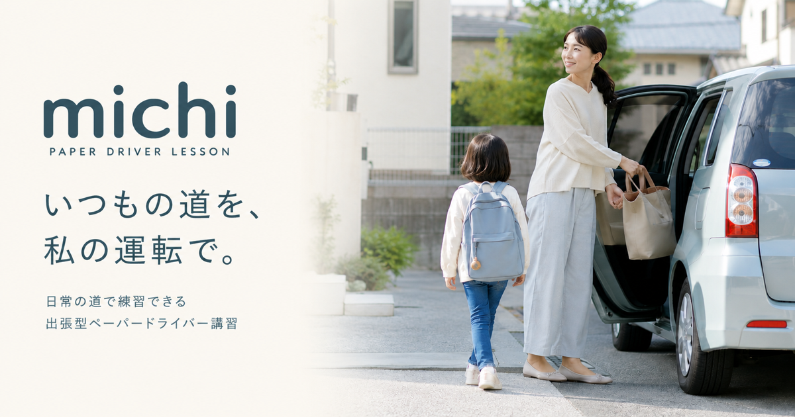

# michi PAPER DRIVER LESSON

子どもの送迎などをきっかけに運転を再開したい人向けの、架空の出張型ペーパードライバー講習LPです。

## Live Demo

https://coconattsu0723.github.io/michi-paper-driver-lp/

## Overview

- 自主制作の架空サービス
- 1ページ構成のランディングページ
- モバイルファーストで設計・実装
- 日常で実際に使う道を練習するサービス設計

## Concept

Brand Message：**いつもの道を、私の運転で。**

「運転を克服する」ことではなく、必要なときに自分で動ける日常を取り戻すことをサービス設計の中心にしています。

## Target

- 子どもの送迎をきっかけに運転を再開したい人
- 久しぶりの運転に不安がある人
- 駐車・狭い道・車線変更などが怖い人

## Main Features

- 実際の送迎・生活ルートで練習
- Driving Check（4問診断）
- Safety情報
- Instructor紹介
- Voice
- Price
- FAQ
- Reservation Form
- Privacy Policy
- SP固定CTA

## Design

- Calm Everyday Driving
- 教習所らしさより、暮らしに寄り添う生活サービスとしての印象を重視
- Warm Ivory / Blue Gray / Deep Slateを中心とした配色
- 写真・余白・細いBorderで情報を整理
- モバイルファースト

## Responsive

確認幅：`375 / 390 / 768 / 1024 / 1366 / 1440`

Breakpoint：`768px / 1024px`

- 768px以上でTablet向け構造
- 1024px以上でPC Navigation
- 1366px / 1440px専用Breakpointは設けず、共通ルールで調整

## Implementation

使用技術：HTML / CSS / Vanilla JavaScript

- SP MENU
- Driving Check
- FAQ Accordion
- Form Validation
- Demo Completion UI
- SP Fixed CTA
- Responsive Layout

## Accessibility

- Semantic HTML
- `h1`は1つ
- `aria-expanded` / `aria-controls`
- `focus-visible`
- Formの`label`
- Error Focus
- Keyboard操作
- Contrast確認

## Performance

写真7点をWebPへ最適化しました。

- PNG合計：約14.60MB
- WebP合計：約455KB
- 削減率：約96.88%

Hero画像には`fetchpriority="high"`を設定し、Lazy Loadは使用していません。Hero以外の対象画像には`loading="lazy"`を設定しています。

## SEO / Social

- title
- description
- canonical
- OGP
- Twitter Card
- favicon

## Portfolio Notice

このサイトはWebデザインのポートフォリオ用に制作した架空サービスです。実際の予約・問い合わせはできません。
